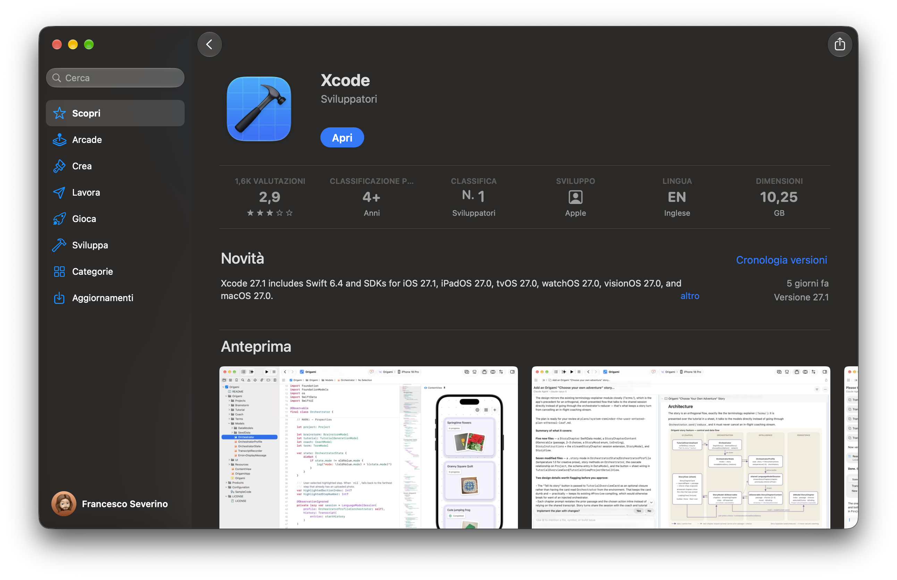

# Install on macOS

To use Vapor on macOS, you will need Swift 6.4 or greater.
Swift and all of its dependencies come bundled with Xcode.

## Install Xcode

Install [Xcode](https://apps.apple.com/us/app/xcode/id497799835?mt=12) from the Mac App Store.



After Xcode has been downloaded, you must open it to complete the installation. This may take a while.

Double check to ensure that the installation was successful by opening the Terminal and printing the Swift's version.

```sh
swift --version
```

You should see Swift's version information printed.

```sh
swift-driver version: 1.168.6 Apple Swift version 6.4 (swiftlang-6.4.0.34.1 clang-2100.3.34.1)
Target: arm64-apple-macosx27.0.0
```

Vapor 5 requires Swift 6.4 or greater.

## Install Toolbox

Now that you have Swift installed, let's install the [Vapor Toolbox](https://github.com/vapor/toolbox).
This CLI tool is not required to use Vapor, but it helps to create new Vapor projects.

### Homebrew

The Toolbox is distributed via Homebrew.
If you do not have Homebrew yet, visit <a href="https://brew.sh" target="_blank">brew.sh</a> for install instructions.

```sh
brew install vapor
```

Double check to ensure that the installation was successful by printing help.

```sh
vapor --help
```

You should see a list of available commands.

### Makefile

If you want, you can also build the Toolbox from source.
View the Toolbox's <a href="https://github.com/vapor/toolbox/releases" target="_blank">releases</a> on GitHub to find the latest version.

```sh
git clone https://github.com/vapor/toolbox.git
cd toolbox
git checkout <desired version>
make install
```

Double check the installation was successful by printing help.

```sh
vapor --help
```

You should see a list of available commands.

## Next

Now that you have installed Swift and Vapor Toolbox, create your first app in [Getting Started &rarr; Hello, world](../getting-started/hello-world.md).
